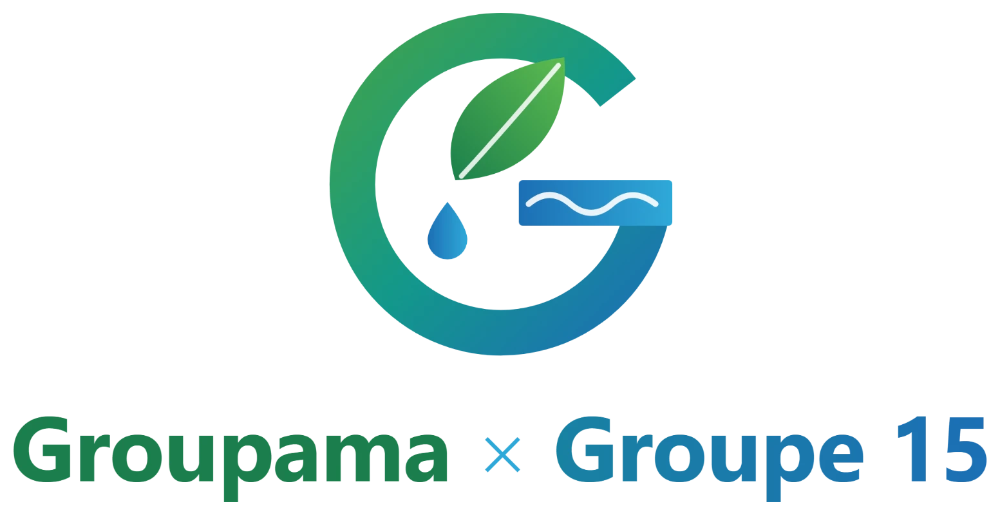

<div align="center">



# Cultiver l'IA — Groupama × Groupe 15

*Comme l'eau nourrit la terre, cultivons l'intelligence et faisons grandir les talents de demain.*


</div>

---

## Présentation

**Cultiver l'IA** est la plateforme interne imaginée par le **Groupe 15** pour accompagner les collaborateurs de Groupama dans l'adoption de l'intelligence artificielle.

Elle présente le projet **CAP IA** : cinq actions concrètes pour développer les compétences, alléger les tâches répétitives et transmettre les savoir-faire, tout en préservant ce qui fait la force d'un assureur mutualiste — l'écoute, le conseil et la décision humaine.

> **+ IA → + Compétences → + Protection des sociétaires**

Le site s'appuie sur une métaphore naturelle : l'IA est l'**eau** qui nourrit, les collaborateurs sont les **racines**, les talents sont les **fleurs**.

## Fonctionnalités

| Page | Contenu |
|---|---|
| **Accueil** `/` | Hero animé, quatre piliers, arbre des talents interactif, chiffres clés, témoignages, charte en 4 règles |
| **Anticiper** `/anticiper` | Carte prédictive des risques, IA prédictive à trois échelles (sociétaire, portefeuille, stratégie), vision 2030, bibliothèque de cas filtrable |
| **Grandir** `/grandir` | Les 5 actions CAP IA : Copilote Groupama, Skill Academy, Binôme 360, Lab IA, Passeport compétences — et la prédiction des compétences de demain |
| **Simplifier** `/simplifier` | Simulateur de temps gagné, démonstration de synthèse, modèles de mails, veille concurrentielle |
| **Relier** `/relier` | Place de l'humain, répartition des rôles humain / IA, guide d'usage en 5 chapitres, FAQ |
| **Le projet** `/projet` | Objectifs, calendrier sur 12 mois, budget sur 5 ans, indicateurs de réussite, cadre réglementaire |
| **Mon parcours** `/parcours` | Tableau de bord personnel : arbre de compétences, progression, badges, formations |
| **Charte IA** `/charte` | Gouvernance, éthique, RGPD, AI Act, humain dans la boucle, sobriété |
| **À propos** `/a-propos` | Racines mutualistes et présentation du Groupe 15 |

Un assistant conversationnel, **« Le Jardinier IA »**, est accessible depuis toutes les pages.

### Qualité

- Responsive, du mobile (390 px) au grand écran
- Accessibilité visée WCAG 2.1 AA : navigation clavier, contrastes, rôles ARIA, alternatives textuelles
- Respect de la préférence « réduire les animations »
- Pages générées statiquement, contenu entièrement séparé du code

## Stack technique

- [Next.js 16](https://nextjs.org/) — App Router, Server Components, Turbopack
- [React 19](https://react.dev/)
- [TypeScript](https://www.typescriptlang.org/) en mode strict
- [Tailwind CSS](https://tailwindcss.com/) — design tokens issus du logo
- [Framer Motion](https://www.framer.com/motion/) — animations
- [Lucide](https://lucide.dev/) — icônes

## Démarrage

**Prérequis** : Node.js 20.9 ou supérieur.

```bash
git clone https://github.com/ilyas-design/groupama_grp15.git
cd groupama_grp15
npm install
npm run dev
```

Le site est disponible sur [http://localhost:3000](http://localhost:3000).

| Commande | Rôle |
|---|---|
| `npm run dev` | Serveur de développement |
| `npm run build` | Build de production |
| `npm start` | Lance le build de production |
| `npm run lint` | Vérification ESLint |

## Structure du projet

```
app/            Routes (une page par dossier), layout global, API de l'assistant
components/
  ui/           Composants partagés (boutons, cartes, onglets, compteurs…)
  layout/       Navigation, pied de page, en-têtes de page
  <page>/       Composants propres à chaque page
content/        Tous les textes du site, un fichier par page
lib/            Types partagés
public/         Logo, favicon, image de partage
```

## Modifier le contenu

Aucun texte n'est écrit dans les composants : tout se trouve dans `content/`.

| Fichier | Contenu |
|---|---|
| `content/site.ts` | Navigation, slogans, pied de page |
| `content/home.ts` | Page d'accueil |
| `content/anticiper.ts`, `grandir.ts`, `simplifier.ts`, `relier.ts` | Pages thématiques |
| `content/projet.ts` | Fiche projet CAP IA (budget, calendrier, indicateurs) |
| `content/parcours.ts` | Tableau de bord |
| `content/assistant.ts` | Réponses de l'assistant |
| `content/transverse.ts` | Charte, à propos, page 404 |

Pour mettre un mot en italique dans un titre, entourez-le d'astérisques : `'Lire le ciel *avant l’orage*.'`

## Assistant IA

L'assistant fonctionne sans configuration grâce à des réponses préparées. Pour le connecter à l'API Claude d'Anthropic, ajoutez ces variables d'environnement (fichier `.env.local` en local, ou réglages de l'hébergeur) :

```bash
ANTHROPIC_API_KEY=sk-ant-...
ANTHROPIC_MODEL=claude-sonnet-5-5   # optionnel
```

La clé reste côté serveur (`app/api/chat/route.ts`). En cas d'indisponibilité de l'API, l'assistant revient automatiquement aux réponses préparées.

## Déploiement

Le site est déployé sur [Vercel](https://vercel.com/) : **https://groupama-grp15.vercel.app**. Chaque push sur `main` déclenche un nouveau déploiement.

## Équipe

Projet réalisé par le **Groupe 15** pour **Groupama**.

---

<sub>Projet pédagogique. Les chiffres, noms, témoignages et concurrents (A, B, C) présentés sur le site sont fictifs. Le budget et les indicateurs sont des propositions du Groupe 15.</sub>
